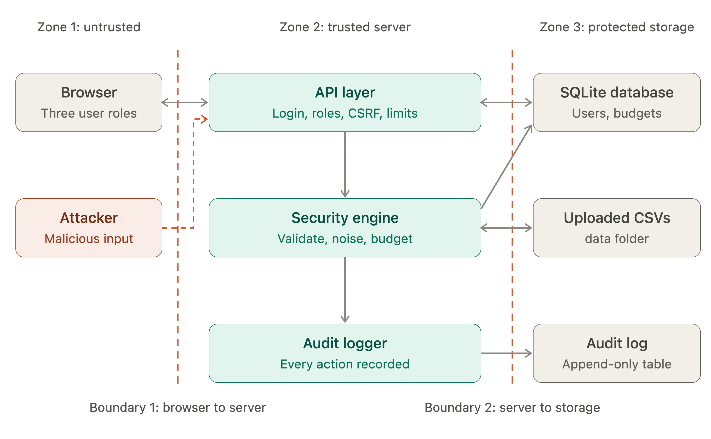
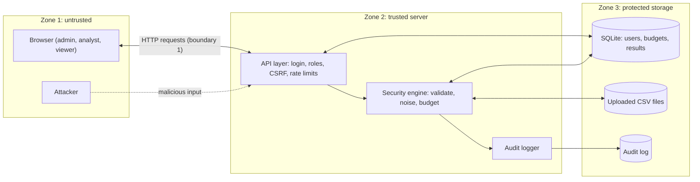

# Data-flow diagram and trust boundaries

## Boundary 1: browser to server
Everything arriving here is untrusted. Controls applied before any processing:
- Session login with bcrypt-hashed passwords, 30-minute expiry, signed cookie
- Server-side role check on every endpoint (admin, analyst, viewer)
- CSRF header required on every state-changing request
- Rate limits on login, uploads and queries
- File type, size, row, column and content checks on uploads
- Whitelisted query options only (no free-form SQL)
- Safe errors: stable codes, no stack traces

## Boundary 2: server to storage
- Parameterized SQL queries only
- Uploaded files stored under server-generated IDs, never user-supplied names
- Analysts and viewers never receive raw rows or true values, only noisy results
- Audit log is append-only (no update or delete code path)
- Signing key kept outside the code and the repository

## Data stores
| Store | Contents | Who can reach it |
|---|---|---|
| SQLite database | users (hashed), datasets, budgets, saved results, settings | server only |
| data folder | uploaded CSV files | server only |
| Audit log table | every login, upload, query, denial, config change, export | admins, read-only through the API |

Note: the demo runs on plain HTTP on localhost. A real deployment would need HTTPS (listed in the limitations).